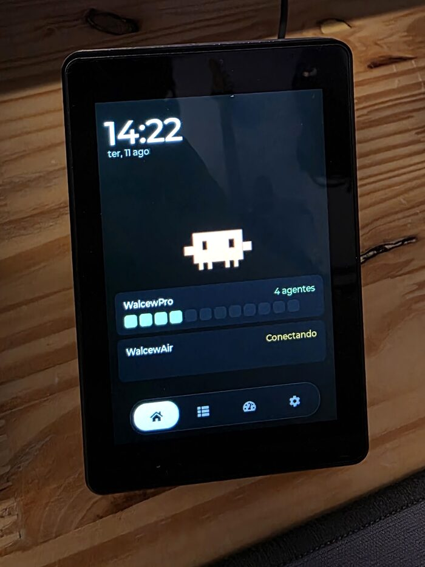
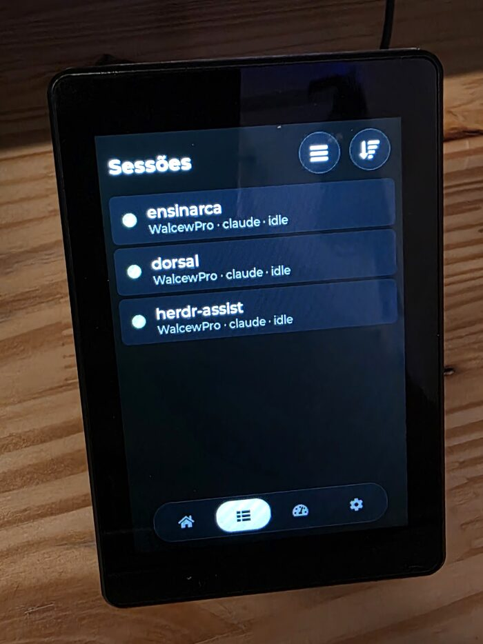
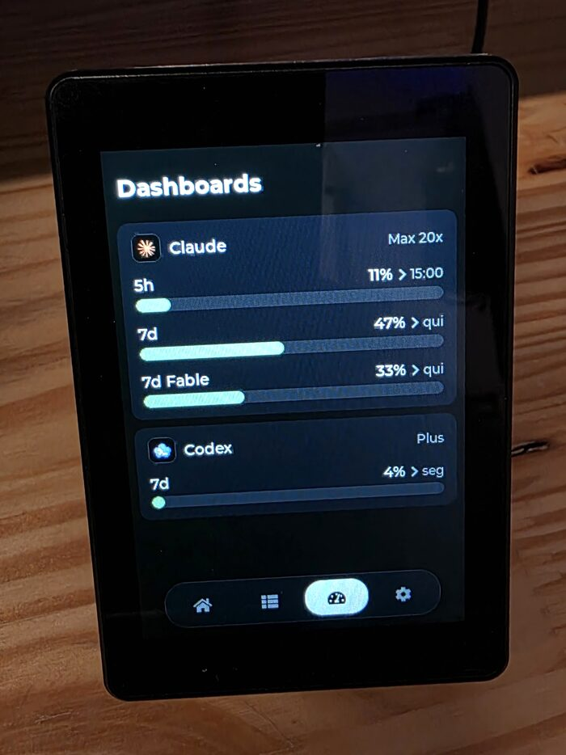
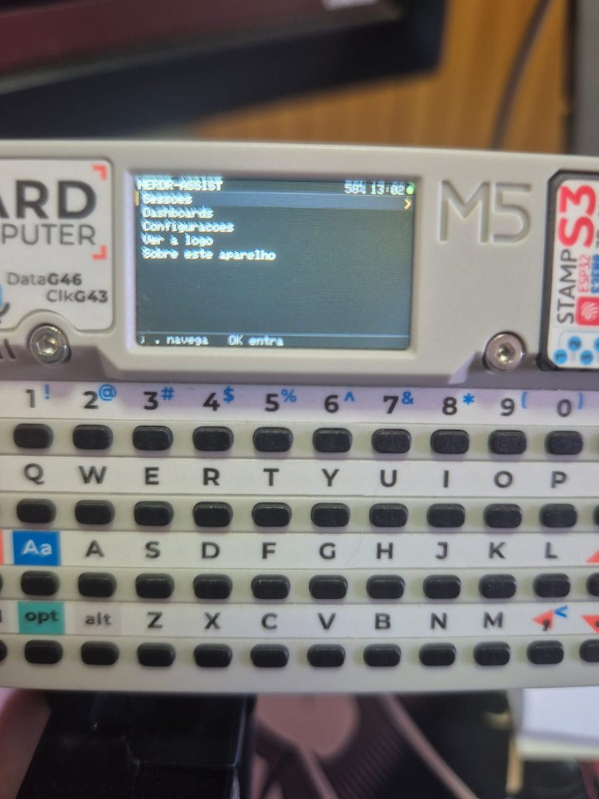
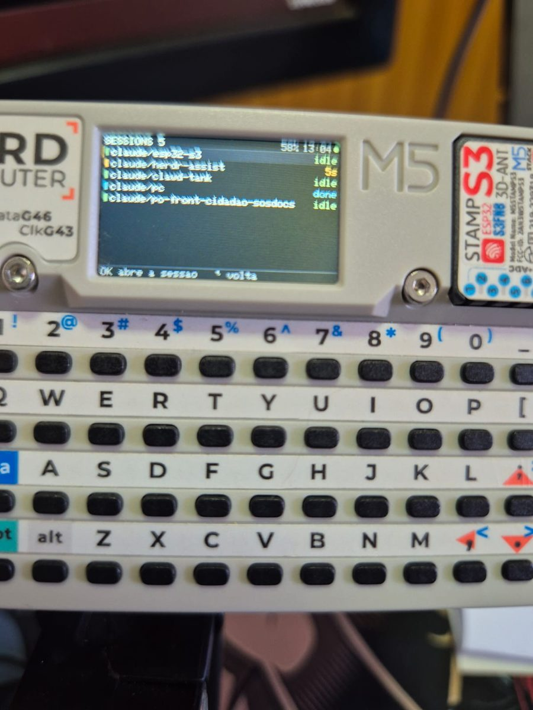
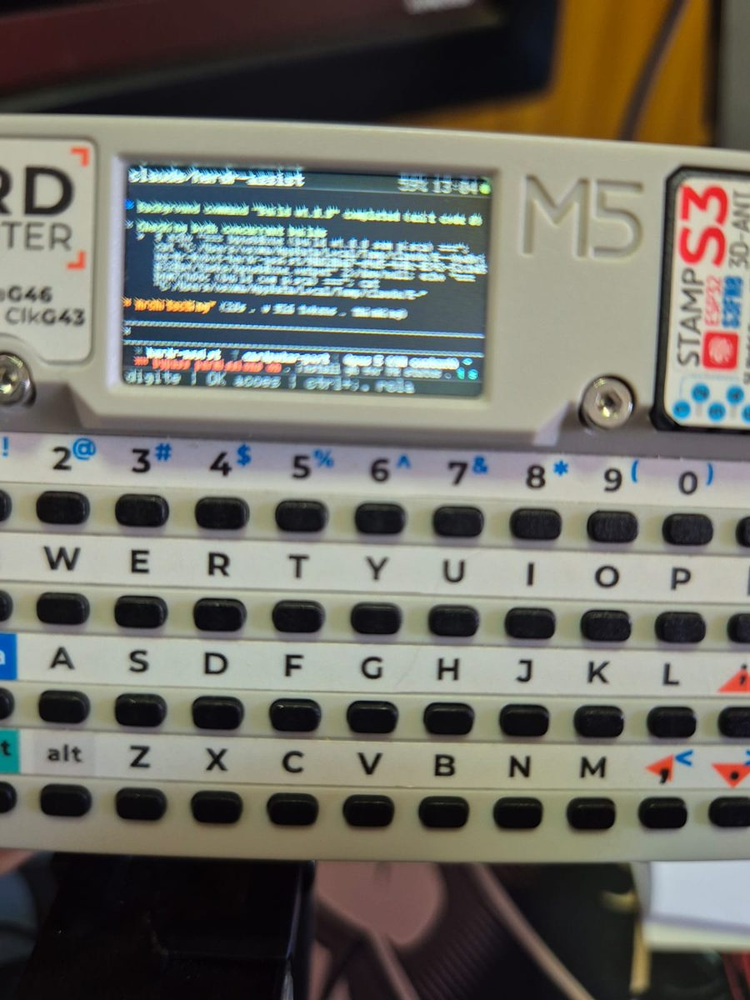

# herdr-assist

> 🇺🇸 **This document is also available in English:** [README.md](README.md)
>
> ⚠️ O idioma principal do projeto é o inglês. Esta versão é mantida em paralelo, mas
> em caso de divergência o [README.md](README.md) é a referência.

Painel físico dedicado para monitorar e controlar sessões do [Herdr](https://herdr.dev) —
o multiplexador de terminal para agentes de código. Roda num kit ESP32-S3 com display
touch de 3.5", ficando na mesa ao lado do teclado: os agentes aparecem com o estado em
cores, e quando um deles para para pedir uma decisão o painel toca um sino que abre a
sessão certa com um toque, sem precisar procurar a janela no terminal.

| Home | Sessões | Dashboards |
|:---:|:---:|:---:|
|  |  |  |
| Relógio, mascote e um mapa de calor por host | Sessões com estado, agrupadas por host | Limites de uso do Claude e do Codex |

> **Requer o Herdr desktop.** Este painel é um cliente, não um dispositivo independente —
> ele precisa do app [Herdr](https://herdr.dev) desktop (`herdr-app` + herdr-core) rodando
> em cada máquina que você quiser monitorar. A ponte em `mod/herdr-assist/` é um mod do
> Herdr desktop e fala com o herdr-core (`hc`), então tudo que o painel mostra vem do fluxo
> de eventos dele. O plugin antigo do Herdr TUI ficou congelado na **v0.14.1**
> (`git checkout v0.14.1`); ele não enxerga os agentes que rodam no app desktop.

## Começando

Três passos: gravar o painel, instalar a ponte na máquina que você quer controlar e
parear os dois. **Sem toolchain e sem compilar** — o release traz os binários prontos.

### 1. Gravando o painel

Baixe os binários da
[página de releases](https://github.com/walcew/herdr-assist/releases/latest), ligue a
placa na USB e grave a imagem:

```sh
# o esptool é o único requisito
pipx install esptool          # ou: brew install esptool

# descubra a porta — ela muda conforme a entrada USB usada
esptool.py chip_id            # macOS: /dev/cu.usbmodemXXXX, Linux: /dev/ttyACM0

esptool.py --chip esp32s3 --port /dev/cu.usbmodemXXXX \
    write_flash 0x0 herdr-assist-v0.5.0-install.bin
```

O painel reinicia na tela de configurações: escolha sua rede Wi-Fi na lista e digite a
senha. Deixe os hosts em branco por enquanto — o passo 3 preenche para você.

> **Instalar × atualizar.** A imagem `-install.bin` cobre de `0x0` a `0x10000`, faixa que
> inclui a partição NVS, então ela **apaga a configuração do painel** (Wi-Fi, hosts,
> tokens, idioma). É o que se quer numa placa nova — e o **caminho obrigatório na
> migração a partir da v0.4.0 ou anterior**, cuja tabela de partições não tem slots OTA.
>
> Da v0.5.0 em diante o painel **se atualiza sozinho**: Configurações → Dispositivo →
> Atualizar firmware, e um aviso anuncia releases novos (checagem diária). O USB só
> volta a ser necessário se o painel não alcançar o GitHub; nesse caso, apague o
> otadata antes (para o bootloader bootar o slot que será gravado) e grave só o app,
> preservando a configuração:
>
> ```sh
> esptool.py --chip esp32s3 --port /dev/cu.usbmodemXXXX erase_region 0xd000 0x2000
> esptool.py --chip esp32s3 --port /dev/cu.usbmodemXXXX \
>     write_flash 0x10000 herdr-assist-v0.5.0-update.bin
> ```

> **Se a gravação cair no meio, coloque a placa em modo download antes**:
> segure o BOOT, toque no RST e solte o BOOT (a tela fica apagada — é o
> esperado). Um painel sem app bootável reseta cerca de uma vez por segundo, e
> cada reset reenumera o dispositivo USB, o que corta o esptool no meio da
> escrita e deixa o slot pela metade — a falha se realimenta. Em modo download
> o chip não reseta sozinho e a gravação vai até o fim.

### 2. Instalando a ponte no host

A ponte é um mod do app Herdr desktop. Em cada máquina que você quiser alcançar pelo
painel, copie a pasta do mod (do repositório, ou do asset `herdr-assist-mod.tar.gz` do
[release mais novo](https://github.com/walcew/herdr-assist/releases/latest)) para o home
do app e mescle o atalho dele no seu:

```sh
cp -R mod/herdr-assist ~/.config/herdr-app/mods/herdr-assist
# keys.json: acrescente  "cmd-alt-a": "mod.open:herdr-assist"  em "global" no ~/.config/herdr-app/keys.json
```

Na primeira vez que o app vê a pasta, ele encaixa um indicador pequeno no rodapé do
layout ativo; essa cópia é quem sobe a ponte quando o app abre, e clicar nela abre o
dialog de controle (também `cmd-alt-a`, ou `herdr-app do mod.open --name herdr-assist`).
A ponte é stdlib pura do Python: funciona com o `python3` de fábrica do macOS (3.9+), sem
toolchain. O resto — o bloco do rodapé como entrada manual no layout, como deixar o plugin
antigo do Herdr TUI, o doc de configuração, o log e as regras de firewall — está em
[`mod/herdr-assist/README.md`](mod/herdr-assist/README.md).

**Depois disso o mod se atualiza sozinho.** Uma vez por dia a ponte compara o `VERSION`
do mod com o do release mais novo (o mesmo `manifest.json` que o painel consulta, já que a
tag é a mesma para os dois), baixa o `herdr-assist-mod.tar.gz`, troca a pasta do mod de
forma atômica e reinicia a si mesma. Ela também percebe em até um minuto se o código em
disco mudou por baixo dela.

Para desligar, ponha `"auto_update": false` no doc `herdr-assist` do core (veja o README
do mod). Uma pasta **symlink** (ou um checkout com `tests/`) nunca é trocada: ali quem
atualiza é o `git pull`. Para mexer no mod, `git clone` do repositório +
`ln -s <checkout>/mod/herdr-assist ~/.config/herdr-app/mods/herdr-assist`.

A versão de cada ponte aparece no dialog de controle e, no painel, em
**Settings → Update firmware**, junto da versão instalada — é onde se vê que um host ficou
para trás.

### 3. Pareando o painel

Digitar 32 caracteres hexadecimais num touch de 3,5" é inviável, então o sentido da
configuração se inverte: **o host manda a configuração pronta para o painel**.

1. No painel: **Settings → Pair with a host**. A tela mostra um código de 6 caracteres e
   passa a se anunciar por broadcast UDP por 3 minutos.
2. No host, no app Herdr desktop, tecle `cmd-alt-a` para abrir o dialog de controle e vá
   na aba **Parear**.
3. Clique em **Parear** na linha com o código que aparece na tela do painel.

O host envia nome, endereço, porta e token; o painel grava na NVS e reinicia já
conectado. Nada é digitado no touch.

Passo a passo com telas, pareamento no Windows/headless, cadastro manual para redes
que filtram broadcast e resolução de problemas: **[manual de
pareamento](docs/pairing.pt-BR.md)** — o mesmo guia que o QR code da tela Parear
do painel abre.

Pronto — o painel já lista suas sessões. O resto deste documento é referência.

## Idioma

A interface fala **inglês e português**, e o firmware é o mesmo nos dois casos: o idioma
sai da NVS (**Settings → Device → Language**, que alterna no toque) e vale a partir do
reinício, junto com o resto da config. De fábrica o painel liga em inglês. O dialog de
controle no host segue o idioma do sistema (pt → português, o resto → inglês;
`HERDR_ASSIST_LANG` força).

## Orientação

O painel roda **em pé (320×480) ou deitado (480×320)**, escolha feita em **Settings →
Device → Orientation**, que alterna no toque e vale a partir do reinício — igual ao idioma.
Retrato é o padrão de fábrica e o modo nativo do painel.

Deitado, o dock sai da borda de baixo e vai para a esquerda, e a home se divide em duas
colunas: relógio e mascote à esquerda, cards de host à direita. O resto — listas, terminal,
teclado, padrão de bloqueio — se redimensiona para a nova proporção. O terminal em especial
troca altura por largura, saindo de ~43×19 para 66×10 células, e a ponte é avisada da nova
geometria.

## Avatares

O mascote da home é um **pacote**, não código compilado. Um motor só toca qualquer arquivo
`.hav`: o Clawd de fábrica, embutido na flash, e o que mais estiver no **cartão microSD**
do painel. Tocar no mascote cicla entre os instalados.

Antes disso, cada avatar era um driver com os sprites em arrays `static const` — cinco
deles ocupavam 3,2 MB e eram 65% do firmware. Acrescentar um exigia recompilar, e ninguém
de fora do projeto conseguia acrescentar nada. Agora a app cabe em um terço do slot de
flash e um avatar é um arquivo.

**Configurações → Dispositivo → Avatares** lista o que os repositórios cadastrados oferecem
mais o que já está no cartão. Toque na linha para instalar, ou para tornar corrente um já
instalado; a lixeira remove. Repositório é só **uma URL base servindo arquivos estáticos** —
GitHub raw, GitHub Pages, GitLab ou um nginx qualquer, sem API de fornecedor no meio:

```
GET <base>/index.json    {"avatars":[{"id":"sonic","name":"Sonic","size":38392}]}
GET <base>/sonic.hav     →  /sd/avatars/sonic.hav
```

Além do padrão embutido, os repositórios vêm de dois campos naquela tela (salvos na hora,
sem reiniciar), de `/sd/avatars/repos.txt` (uma URL por linha, `#` comenta) e da ponte —
ponha suas URLs em `avatar_repos` no doc `herdr-assist` do core
(veja o [README do mod](mod/herdr-assist/README.md#configuração)) e a ponte as empurra a cada conexão. Id repetido fica com o primeiro que apareceu, e o repositório padrão é lido
primeiro: um repositório de terceiro não sequestra o nome de um avatar oficial.

Todo pacote é validado antes de merecer confiança — magic, tabela de animações, offsets de
frame, índices de sequência — e o decoder de RLE é limitado pelo fim do buffer, porque
pacote vem de cartão ou da internet. Pacote que não passa é recusado e sai do ciclo de
toque, em vez de travá-lo.

Os pacotes são gerados por `scripts/hav_pack.py` e o formato está documentado em
`src/avatar_pack.h`. Ler um leva segundos no cartão (1,5 MB a ~520 KB/s), então o motor
carrega numa task separada: o avatar atual segue animando, esmaecido, até o novo chegar.

## Hardware

**JC3248W535EN** (Guition/Sunton), ~R$ 120 no AliExpress:

| Componente | Especificação |
|---|---|
| MCU | ESP32-S3-WROOM-1 (240 MHz, 2 cores) |
| Memória | 8 MB PSRAM (OPI) + 16 MB flash |
| Display | 3.5" IPS 320×480, controlador AXS15231B via QSPI |
| Touch | Capacitivo, mesmo AXS15231B, via I2C (SCL 8 / SDA 4) |
| Rede | Wi-Fi 2.4 GHz + BLE |
| Armazenamento | Slot microSD (TF), SPI em IO10/11/12/13 — guarda os pacotes de avatar |

Pinout relevante em `src/esp_bsp.h`; esquemáticos e datasheets em `docs/`.

### Fita de LED (opcional)

Uma fita de **7 LEDs endereçáveis WS2812B** no conector **P3** (JST 1,25 mm, 4 pinos)
mostra o mesmo estado global do mascote, legível de relance do outro lado da sala — mesmo
com a tela bloqueada. O P4 (1,0 mm) tem os mesmos sinais e também serve.

| Pino do P3 | Sinal | Fita |
|---|---|---|
| 1 | GND | GND |
| 2 | 3.3V | VCC |
| 3 | IO17 | IN (dados) |
| 4 | IO18 | sem uso |

> **Confira o cabo com o multímetro antes de ligar a fita.** A cor do fio não garante a
> ordem: com o painel ligado, entre o preto e o vermelho deve dar ~3,3 V. Inverter VCC e
> GND queima a fita. O fio de dados vai na ponta **DIN** da fita (a seta aponta para longe
> dela).

| Estado | Cor | Animação |
|---|---|---|
| Bloqueado (um agente precisa de você) | vermelho | pulso duplo rápido e pausa, no ritmo do sino |
| Finalizado (terminou, ainda não aberto) | ciano | respiração, ~2 s |
| Trabalhando | âmbar | cometa de ponta a ponta, ~1 volta/s |
| Ocioso | verde | respiração lenta, ~6 s |
| Nenhum host online | branco fraco | um único LED pisca a cada ~3 s |

No boot a fita pisca vermelho → verde → azul para provar que todos os LEDs funcionam e que a
ordem de cor está certa. O slider **Configurações → Dispositivo → LED** ajusta o brilho da
fita em passos de 5%, na hora e sem reiniciar; em 0 ela apaga (e pula o pisca do boot). O 100%
é o teto (`LED_FX_MAX` em `src/led_fx.h`), porque a fita divide o regulador de 3.3V com o
ESP32 e o display. O slider **Brilho da tela**, logo acima, ajusta o backlight do display
(10–100%).

### Outras placas: M5Stack Cardputer

Em `cardputer/` há um porte para o **M5Stack Cardputer** (240×135 e um teclado de
56 teclas), um projeto PlatformIO à parte, em Arduino + M5GFX. Fala com a mesma
ponte, pareia do mesmo jeito e divide com o painel os módulos de protocolo — e,
por ter teclado, responde os agentes com texto livre, não só com as teclas da
allowlist. Veja [`cardputer/README.md`](cardputer/README.md).


|  |  |  |
|:---:|:---:|:---:|

🎬 [Veja rodando](https://youtube.com/shorts/AlCFoE3ng9Y)

### Outras placas: Waveshare ESP32-S3-ePaper-1.54

Em `epaper154/` há um **pager** para o Waveshare ESP32-S3-ePaper-1.54 (e-paper
200×200 preto e branco, dois botões, alto-falante). Ele faz uma coisa só: mostra
qual agente está esperando, toca um sino no instante em que um deles bloqueia e
responde com um botão — PWR escolhe a sessão (e a foca no Herdr), BOOT manda
Enter. Mesma ponte, mesmo pareamento, mesmo OTA; o Wi-Fi é configurado pelo
celular, num ponto de acesso do próprio pager, já que ele não tem teclado nem
touch. É ESP-IDF como o painel, então divide com ele os módulos de protocolo,
Wi-Fi, pareamento e atualização. Veja [`epaper154/README.md`](epaper154/README.md).

|  |  |  |
|:---:|:---:|:---:|

## Arquitetura

O herdr-core expõe sua API só na máquina local (`hc connect`, JSONL em stdin/stdout), que um
dispositivo na rede não alcança. A ponte (`mod/herdr-assist/herdr_bridge.py`, stdlib pura)
traduz isso para TCP e nada mais: ela assina os eventos do core (`events.subscribe`), então
o painel recebe as mudanças por **push**, sem polling. Ela é empacotada como **mod do Herdr
desktop** (`mod/herdr-assist/`), que mantém a ponte rodando como terminal do core — um mod
por máquina que você queira controlar pelo painel.

```
┌─ JC3248W535EN ─────────────┐     Wi-Fi / LAN      ┌─ Mac ───────────────────────┐
│ herdr-assist               │ ◄── TCP + JSON ───►  │ ponte herdr-assist (:9375)  │
│ ESP-IDF 5.2 + LVGL 8.4     │    uma msg por       │          │ hc connect       │
│ UI: lista, terminal, ações │    linha             │          ▼                  │
└────────────────────────────┘ ◄─ descoberta UDP ─► │  herdr-core (events)        │
                                  (:9375, auto)     └─────────────────────────────┘
```

**Painel → ponte:** `hello` (token, obrigatório na 1ª linha), depois `read_pane`
(leva também a geometria da tela do painel), `send_keys`, `send_text`, `focus`,
`scroll_pane`, `release_pane`, `ping`.
**Ponte → painel:** `agents` (estado de todos, incluindo quem está `blocked`),
`pane_content` (tela do terminal **com SGR/cores**, fiel ao host —
só linhas em branco do fim são removidas; quem emula é o motor do Ghostty embutido no
Herdr, via `pane.read format:"ansi"`, e o painel só parseia SGR e pinta), `limits`
(uso de limites dos provedores de IA para a aba Dash — coletado dos endpoints de uso
do Claude Code e do Codex com as credenciais que os próprios CLIs mantêm renovadas em
`~/.claude/.credentials.json` e `~/.codex/auth.json`; nenhum token sai do Mac, só
percentuais), `pong`.

O pareamento por linha de comando (sem o dialog) é o `mod/herdr-assist/ctl.py discover` e o
`ctl.py pair <ip> <porta>`.

A ponte é o ponto onde as decisões de segurança acontecem, porque qualquer um na LAN
alcança essa porta. **Toda conexão exige um token** (handshake `hello` na primeira linha;
sem ele, a ponte desconecta em 5 s). Além disso: só teclas de uma allowlist passam, texto
tem limite de tamanho, e comandos só valem para panes que existem. O token é gerado na
primeira subida da ponte e fica no doc `herdr-assist` do core; a aba Token do dialog de
controle exibe o valor.

### Descoberta de host (modo auto)

DHCP muda os hosts de endereço, então um slot pareado a partir da ponte 0.4 **não
guarda IP nenhum**: o painel encontra a ponte por broadcast UDP (`herdr-find` →
`herdr-here`, mesma porta 9375) no boot e sempre que a conexão cai, mantendo o endereço
descoberto só em RAM. O handshake prova posse do token sem nunca colocá-lo no ar — a
resposta carrega `h = HMAC-SHA256(token, "nonce|ip|port|name")`, e o painel adota o
ip/port **assinados**, nunca o remetente do datagrama, para um vizinho não conseguir
redirecionar o painel reaproveitando probes. Digitar um endereço no editor de host
desliga a descoberta daquele slot (modo estático) — use em redes que filtram broadcast.
O modo auto exige ponte ≥ 0.4 no host; a descoberta compartilha os requisitos do
pareamento (mesmo segmento L2, broadcast liberado) e requer o `BRIDGE_BIND` padrão
`0.0.0.0` (bind num endereço específico fica surdo a broadcast).

## Usando o dialog de controle

No app Herdr desktop, `cmd-alt-a` (ou o indicador do rodapé, ou
`herdr-app do mod.open --name herdr-assist`) abre um dialog com três abas: **Status**
(ponte ativa, versão, porta, IP na LAN, painéis conectados, **Reiniciar ponte**), **Token**
(mostrar e rotacionar) e **Parear** (descoberta, envio da configuração, QR do manual de
pareamento). Se a porta 9375 estiver com outra ponte — tipicamente a do Herdr TUI antigo —
a aba Status avisa e oferece **Encerrar** (com confirmação; nada é morto sozinho).

A configuração da ponte (token, porta, repositórios de avatar, atualização automática)
fica no doc `herdr-assist` do core e vale sem reiniciar; o log da ponte é a saída do
próprio terminal — os dois estão no [README do mod](mod/herdr-assist/README.md).

## Compilando do código-fonte

Só é preciso se você for mexer no firmware — para apenas usar o painel, veja
[Começando](#começando).

Requer [PlatformIO](https://platformio.org/) (`pipx install platformio`). A toolchain
ESP-IDF é baixada sozinha na primeira build (~1 GB).

```sh
pio run                                        # compila
pio device list                                # a porta muda conforme a entrada USB
pio run -t upload --upload-port /dev/cu.usbmodemXXXX
```

O firmware é genérico — nenhuma credencial é compilada. No primeiro boot (ou após
apagar a NVS) o painel abre a tela de configurações: escolha a rede Wi-Fi na lista,
digite a senha e cadastre até 4 hosts Herdr (nome, IP ou hostname, porta e **token**
da ponte). Tudo fica na NVS e sobrevive a reflashes do app; salvar reinicia o painel.

Para regenerar a fonte do terminal (só é preciso ao mudar os ranges de glifos):

```sh
./scripts/gen_font.sh
```

### Publicando um release

Empurre uma tag `v*` e [o workflow](.github/workflows/release.yml) compila, mescla a
imagem de instalação e publica o release com os dois binários, seus checksums e um
`manifest.json` de nome fixo — o arquivo que os painéis consultam (via
`releases/latest/download/`) para descobrir atualizações OTA:

```sh
git tag -a v0.5.0 -m "v0.5.0"
git push origin v0.5.0
```

A versão embutida no binário vem da tag (o workflow a grava em `version.txt` antes de
compilar), então o `strcmp` do painel contra o manifest bate exatamente. Builds locais
caem no `git describe`, que nunca é igual a uma tag de release — um painel de
desenvolvimento sempre vê o release corrente como "disponível", o que é útil para
testar o fluxo.

## Estrutura

| Arquivo | Papel |
|---|---|
| `mod/herdr-assist/main.js` | Mod de controle (indicador + dialog): desenha a UI e chama o `ctl.py` |
| `mod/herdr-assist/update.py` | Autoatualização: baixa o pacote do mod do release e troca a pasta de forma atômica |
| `mod/herdr-assist/ctl.py` | Operações do Mod de controle (JSON): status, reinício, rotação do token, descoberta e pareamento de painéis |
| `mod/herdr-assist/herdr_bridge.py` | Ponte: herdr-core (`hc`) ↔ TCP, handshake com token, allowlist, sanitização, coleta de uso de limites (Claude/Codex) |
| `src/pairing.c` | Modo de pareamento do painel: anúncio por broadcast + recepção da config |
| `src/DEMO_LVGL.c` | Ponto de entrada: inicializa painel, config, Wi-Fi, conexões e UI |
| `src/panel_cfg.c` | Configuração persistente (NVS): rede Wi-Fi + até 4 hosts Herdr + idioma |
| `src/net.c` | Wi-Fi station com reconexão automática e scan para a tela de config |
| `src/herdr_conn.c` | Uma conexão TCP por host, parse do protocolo, ping e reconexão |
| `src/herdr_model.c` | Estado compartilhado entre as tasks de rede e a da UI (mutex + geração) |
| `src/term_parse.c` | Parser SGR puro (sem LVGL/ESP): snapshot ANSI → grid de runs coloridos; testável no Mac (`scripts/term_parse_test.c`) |
| `src/term_view.c` | Widget custom da tela de terminal: desenha o grid com cor/estilo por run, pan horizontal fiel |
| `src/i18n.c` | Textos da interface (en/pt) numa lista só, que gera enum e tabela |
| `src/ui_theme.c` | Paleta, fontes, topbar e dock compartilhados pelas telas |
| `src/herdr_ui.c` | UI LVGL: home (relógio, mascote, resumo, mapa de calor), sessões, dash de limites, terminal, ações, teclado |
| `src/herdr_ui_settings.c` | Aba de configurações: scan de Wi-Fi, senha, editor de hosts, idioma, atualização de firmware |
| `src/sd.c` | Montagem do microSD (`/sd`) por SPI3, com retry — o cartão guarda estado através de reset a quente |
| `src/avatar_pack.c` | Formato `.hav`: cabeçalho, tabela de animações, validação de pacote vindo de cartão ou da internet |
| `src/avatar.c` | Motor de avatar: toca qualquer pacote, cicla no toque, carrega do cartão fora da task da UI |
| `src/avatar_store.c` | Marketplace de avatares: catálogo dos repositórios, download e instalação; é também a única task de I/O de avatar |
| `src/fw_update.c` | OTA via GitHub Releases: checagem diária do manifest, download com esp_https_ota, confirmação do rollback |
| `src/lv_font_terminal_12.c` | Fonte gerada (não editar) — veja `scripts/gen_font.sh` |
| `src/esp_bsp.c`, `src/esp_lcd_axs15231b.c`, `src/lv_port.c` | BSP do fabricante (display, touch, port LVGL) |

### Notas de implementação

- **`full_refresh = 1`** (`lv_port.c`) não é escolha estética, e sai caro: são 307 KB por
  quadro no barramento QSPI mesmo quando muda uma linha de texto. Duas coisas impedem a
  renderização parcial neste painel. A primeira é conhecida: o driver pulava o RASET (0x2B)
  em QSPI ([esp-bsp#724](https://github.com/espressif/esp-bsp/issues/724)) — já corrigido
  aqui. A segunda não está no issue e foi encontrada na marra: `draw_bitmap` usa **RAMWRC**
  (0x3C, "continua a escrita anterior") sempre que `y_start != 0`, ignorando a janela que
  acabou de definir. Funciona para varredura sequencial, que é o padrão do refresh completo;
  com áreas arbitrárias, cada região vai parar no lugar errado e a tela embaralha. Habilitar
  parcial exige também trocar esse RAMWRC por RAMWR — não testado.
- **A RAM interna é o recurso escasso aqui, não a flash nem a PSRAM.** O chip tem 242 KB
  dela e o painel termina o boot gastando quase tudo: display 80 KB, UI 43 KB, Wi-Fi 66 KB,
  pontes 22 KB. Duas coisas decorrem disso. Criar task pode falhar de verdade, então cheque
  o retorno — a task de avatar não checava, e o marketplace ficou morto em silêncio por
  vários builds. E os dois buffers de transporte do LCD, que movem o framebuffer da PSRAM
  para o painel, eram `hres*vres/10` = 30 KB cada: com eles sobravam ~17 KB e o handshake
  TLS não conseguia alocar (`esp-aes: Failed to allocate memory`), então nem OTA nem
  marketplace funcionavam. Agora são `/20` — 47 KB livres, e um flush de tela cheia custa
  33,7 ms em vez de 29,7 ms (medido).
- **Rotação é sempre por software.** O painel ignora MADCTL, então ela não muda com o
  aparelho ligado: a orientação é lida da NVS no boot e escolhida em `DEMO_LVGL.c`, e
  trocá-la em Configurações → Dispositivo → Orientação salva e reinicia, como toda mudança
  de config. Retrato (0°, 320×480 nativo) dispensa a cópia de rotação no flush; paisagem
  paga por ela e entrega 480×320. Se a paisagem sair de cabeça para baixo na sua base,
  troque `UI_LANDSCAPE_ROT` por `LV_DISP_ROT_270`.
- **O touch é capacitivo e não precisa de calibração** — o que importa é o remapeamento de
  coordenadas conforme a rotação, feito em `lv_port.c`.
- **Fontes**: nenhuma fonte que acompanha a LVGL serve aqui — Montserrat e unscii cobrem
  apenas ASCII 0x20–0x7F, então box-drawing e spinners viram retângulos vazios, e rótulos
  como "Sessões" e "Endereço" perdem os acentos. São duas famílias geradas: o terminal usa
  a JetBrainsMono Nerd inteira (`scripts/gen_font.sh`) e a interface usa a Montserrat com o
  Latin-1 completo, mesclada com a FontAwesome da própria LVGL para os `LV_SYMBOL_*`
  continuarem valendo (`scripts/gen_font_ui.sh`), mais pontuação tipográfica/setas da
  própria Montserrat e `✓ ✗ ⚠ ●` da DejaVu Sans — símbolos que chegam aos alertas em
  texto vindo do terminal. A Nerd Font, mesmo inteira, não cobre tudo que o Claude Code
  desenha (spinner `✢✳✻✽`, `⏺ ⏵ ⏸ ⏳`, `◑ ◼ ✅ ✔ ⧉ ※` — auditado contra o cmap):
  esses viram vizinhos visuais que a fonte tem (`⏺→●`, `✳→✶`, `✅→✓`...) na tabela
  `GLYPH_SWAPS` de `replace_missing_glyphs()` — trocar por outra fonte quebraria o
  grid de 7 px do term_view, que assume avanço uniforme.
- **O idioma é decidido no boot e não muda em runtime.** As telas da LVGL são montadas
  uma vez em `herdr_ui_init()` e ficam vivas escondidas — retraduzir exigiria destruir e
  reconstruir todas elas, ou guardar a chave de cada label. Como trocar de rede ou de host
  já reinicia o painel, o idioma entrou no mesmo caminho: a tela de configurações edita a
  cópia, o toast avisa que falta aplicar, e o reinício resolve. `i18n.h` tem uma lista
  X-macro única (`I18N_STRINGS`) de onde saem tanto o enum das chaves quanto a tabela de
  traduções, então não existe o caso de acrescentar um texto num idioma e esquecer o
  outro — as duas traduções ficam na mesma linha. As tabelas são `const char *const`:
  vivem em flash (3,2 KB de rodata para os dois idiomas juntos, medido no `.o`), e o
  único custo em RAM é o `uint8_t` do idioma em vigor. pt_BR e en_US
  cabem no Latin-1 que as fontes de UI já cobrem, então nada precisou ser regerado.
  O dialog de controle do host (`main.js`) tem a própria tabela
  en/pt e segue o idioma do sistema, não o do painel.
- **A interface segue o projeto "herdr-assist" no Claude Design** — paleta neutra (cor só
  em status), topbar sem barra sólida e dock flutuante de quatro abas. Ao mexer no visual,
  atualize lá também: `src/ui_theme.h` é a tradução direta daquelas telas.
- **A tela de terminal renderiza a formatação real** (`term_parse.c` + `term_view.c`): a
  ponte pede `pane.read` com `format:"ansi"` — o emulador interno do Herdr é o libghostty,
  que re-emite a tela como linhas com SGR (só SGR: sem cursor/OSC, confirmado em amostra
  real) — e o painel parseia isso num grid de runs e desenha com `lv_draw_rect`/`lv_draw_label`
  em célula de 7×19 px (métricas da `lv_font_terminal_12`). Sem re-wrap: o grid fica na
  largura real do pane no host, com âncora vertical no fim e pan preservado entre refreshes —
  o pan horizontal continua existindo como rede para quando a trava de resolução (abaixo) não
  pega. Caps: 220 colunas × 48 linhas × 12 KB (`HERDR_CONTENT_LEN`,
  casado com o cap de 12000 da ponte). Limitações assumidas: itálico não tem efeito visual
  (fonte bpp1 única), bold vira cor clareada (bright na paleta indexada, +30% branco em
  truecolor), e emoji vira `"* "` (2 células, preservando alinhamento). Snapshot idêntico
  não repinta: o dedup por `seq` no model evita o full refresh de 307 KB à toa.
- **Sessão aberta no painel roda na resolução da tela do painel.** Herdar as ~135 colunas do
  host obrigava a arrastar a tela para o lado para ler qualquer coisa, então o `read_pane`
  leva junto a geometria que cabe (`term_view_fit()`: 42 × 18) e a ponte trava o pane nesse
  tamanho enquanto o painel estiver lendo. A API JSON do Herdr não tem tamanho de terminal
  (`pane.resize` é proporção de split), então quem faz isso é a CLI
  `herdr terminal session control <pane_id> --cols N --rows M`, que redimensiona o pty de
  verdade (TIOCSWINSZ) e mantém o tamanho travado enquanto o processo viver. A soltura tem
  três caminhos independentes: `release_pane` ao fechar o detalhe, desconexão do painel, e
  morte da ponte — neste último o filho vê EOF no stdin e se desanexa sozinho, e é por isso
  que o stdin dele é um pipe. Consequência aceita: enquanto travado, esse pane também
  aparece estreito no Herdr do Mac, e cada abertura/fechamento faz o agente reflowar.
- **A rolagem do terminal é a do host, não a do widget.** Arrastar na vertical vira
  `scroll_pane` → `terminal.scroll` com `source:"wheel"` no controller, e daí quem decide é
  o Herdr: app com mouse tracking (Claude Code) recebe o evento e rola o próprio conteúdo,
  senão anda o scrollback do emulador. Por isso o `pane.read` usa `source:"visible"` — é o
  viewport que a rolagem move; com `"recent"` o painel ficaria preso no fim. Duas coisas que
  custaram medição: a **posição** do ponteiro vai junto (célula sob o dedo — com a roda fora
  da área de transcript o Claude Code simplesmente ignora), e uma célula arrastada equivale
  a uma linha. O eixo vertical do LVGL só é liberado quando o conteúdo não cabe
  (`term_view_set_ansi` alterna `LV_DIR_HOR`/`LV_DIR_ALL`), caso em que a trava de resolução
  falhou e rolar localmente é o certo.
- **Decisão pendente é um beacon, não um formulário reconstruído.** Quando algum agente
  entra em `blocked`, um sino vermelho aparece na home — na linha do relógio, do lado
  oposto — balançando até alguém agir; o toque abre a sessão que está esperando (com o
  número de sessões no rótulo quando é mais de uma). Antes disso, a ponte tentava
  reconhecer o formulário por regex, mandava a pergunta e as opções detectadas, e o
  painel montava um modal com um botão por opção; responder fazia a ponte navegar o
  cursor por setas e confirmar. Isso saiu inteiro: com o terminal do painel já rodando na
  resolução da tela e com rolagem, ver a pergunta como ela é e responder com ↑/↓/Enter é
  mais fiel do que adivinhá-la — e some a classe de erro em que o botão não correspondia
  ao que estava na tela. O que sustenta o beacon é o `agent_status` que o `agents` já
  trazia. Consequência assumida: o alerta só existe na home (o modal aparecia sobre
  qualquer tela).
- **O relógio da home depende de SNTP** (`net.c`), com fuso fixo em UTC-3. Sem sincronizar,
  a home mostra `--:--` em vez de uma hora inventada.
- **Detecção de conexão morta** (`herdr_conn.c`): com push, silêncio é o estado normal, então
  não dá para inferir queda pela ausência de dados. O painel manda `ping` a cada 20 s e
  desiste da conexão após 50 s sem resposta — isso cobre o caso em que o TCP fica aberto mas
  para de receber (Wi-Fi que some, Mac que dorme), que de outra forma trava o painel para
  sempre em "conectando".
- **Buffers grandes ficam em memória estática, nunca na pilha**: a task da LVGL tem 8 KB e a
  de rede 6 KB, enquanto uma leitura de terminal sozinha passa de 8 KB. Declarar essas
  structs como variável local estoura a pilha e derruba o device com backtrace corrompido.

## Créditos e licença

O BSP, os drivers de display/touch e o port da LVGL vêm do
[port PlatformIO de NorthernMan54](https://github.com/NorthernMan54/JC3248W535EN),
que empacota o material original do fabricante (Shenzhen Jingcai / Guition). A LVGL 8.4
está vendorizada em `libraries/lvgl`, podada dos demos e exemplos que não entram no build.

O desenho do protocolo (os tipos `agents` / `pane_content`, e o `blocked` com as opções de
aprovação detectadas, que existiu aqui até o beacon substituí-lo) veio do relay do
[herdr-remote](https://github.com/dcolinmorgan/herdr-remote), usado como referência antes de
trocarmos por uma ponte própria falando o socket nativo do Herdr.

MIT — veja `LICENSE`.
