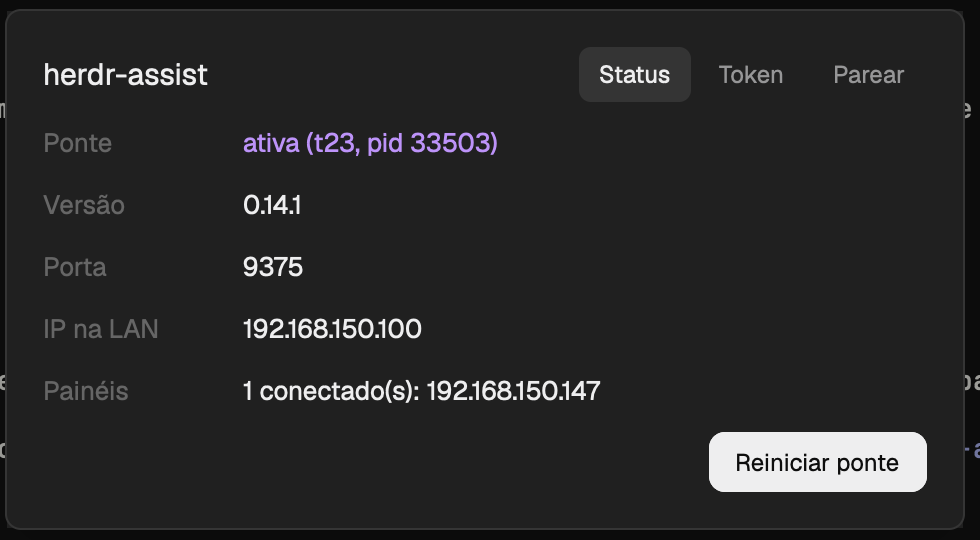

# herdr-assist

A 28px chip at the bottom of the window that shows whether the herdr-assist bridge is running and how many hardware panels (ESP32 touch panel, M5Stack Cardputer, e-paper pager) are connected to it. Click it, or press `cmd-alt-a`, and a dialog opens with the bridge's status, its token and the pairing flow for new panels.

## What you see

**The indicator** is one block, 28px tall, the width of whatever the layout gives it, on the `chrome` color. From left to right, 10px from the edge: an 8px round dot, the text `herdr-assist` in the foreground color, and `· N` in the dim color, N being the number of connected panels (empty until the first status arrives). The whole chip is a button: the hover color on the chip, a pointer cursor.

**The dialog** is a 480px wide overlay on the `popover` color, 18px padding, 10px between rows, 13px text. The top row is the title `herdr-assist` (15px, semibold) followed by three tabs (12px, 10px by 4px padding, 6px radius): Status, Token, Pair. The open tab is on the `selected` color with foreground text; the others are muted. Below the tabs, in this order, a green line with the result of the last action, a red line with the last error, and a dim line while something runs.

- **Status:** five rows with a 90px dim label column: Bridge (`running (t7, pid 4242)` in the done color, or `stopped` in the blocked color), Version, Port, LAN IP, Panels (`2 connected: 192.168.1.40, 192.168.1.41` or `none connected`). A **Restart bridge** button on the right, below. When port 9375 is held by a process that is not this mod's bridge, a bordered box in the blocked color appears with the text (`Port 9375 is taken by another bridge (probably the Herdr TUI one): pid 123, python3.`) and a **Stop it** button; clicking it swaps the box for `Stop process 123? Panels connected to it will drop.` with **Confirm** and **Cancel**.
- **Token:** one row with the token masked as `••••••••` plus its last four characters, and a **Show**/**Hide** button; a **Rotate token** button that asks first (`Every paired panel stops connecting until it is paired again. Rotate?`, Confirm/Cancel) and then shows `New token saved; the bridge already uses it.`
- **Pair:** the line `On the panel: Settings → Pair with a host`, a dim line `listening... N found`, then one row per panel found: its 6-character id (70px, semibold), its IP, and a primary **Pair** button; once one is listed, `Check the code shown on the panel screen.` At the bottom a 120px QR code (`qr-en.svg` or `qr-pt.svg`, by language) with `Pairing manual` under it.

All text follows the system language: Portuguese when it starts with `pt`, English otherwise. Colors come from `theme()`, so the mod follows the app's theme.

## How it behaves

The dot color is the bridge state: `done` (green) when the bridge terminal is alive, `idle` while stopped, `blocked` when port 9375 is held by someone else, `unknown` before the first status. The mod does not show per-agent statuses (working, blocked, done, idle): it is about the bridge, not about the agents.

Every copy, indicator or dialog, calls `ctl.py ensure` when it starts: if no live terminal carries the label `herdr-assist=bridge` and the port is free, it starts the bridge with `hc run --bg --no-parent --label herdr-assist=bridge -- python3 herdr_bridge.py`. Without `herdr.space`/`herdr.tab` labels the bridge stays out of the spaces and tabs and outlives the window. The indicator refreshes every 10 s, the dialog every 3 s (and the Pair tab listens for panels, about 2.5 s per round, while it is open).

- Click on the chip: `mod.open herdr-assist`. `cmd-alt-a` does the same; calling it again closes the dialog.
- Restart bridge: kills the bridge terminal and starts it again, then rereads the status.
- Stop it: sends SIGTERM to the pid shown, only after Confirm, and only if that pid still holds the port and is not the mod's own bridge.
- Rotate token: writes a new token to the `herdr-assist` doc of the core; the bridge applies it on the `doc` event and drops the panels that had the old one.
- Pair: sends the host name, address, port and token to the panel over TCP and shows `Paired with <id>: the panel restarts and connects to this host.`

Once a day the bridge looks for a newer release of the mod, swaps its own folder and restarts. It never touches a folder that is a symlink or a checkout (it has `tests/`), and `auto_update: false` in the doc turns it off.

## Built from

- `mod.json`: `{ "place": "bottom", "size": 28, "title": "herdr-assist", "overlay": { "kind": "dialog", "width": 480 } }`. The same mod is the indicator (`place`) and the dialog (`overlay`); the dialog tells itself apart with `props()?.overlay`. To place the indicator by hand, use `"place": "none"` and a layout block `{ "id": "herdr-assist", "type": "block", "size": { "px": 28 }, "content": { "mod": "herdr-assist" } }`.
- `keys.json`: `{ "global": { "cmd-alt-a": "mod.open:herdr-assist" } }`, to be merged into the person's own.
- `main.js`: one `View` class (`gpui-kit`, `gpui-base`; `exec`, `appHome`, `theme`, `props`, `run` from `herdr`). It only draws and calls `python3 ctl.py <command>` through `exec` (cwd the mod folder, 20 s timeout); every command prints one line of JSON. Calls `run("mod.open", { name: "herdr-assist" })`. Theme roles used: `chrome`, `popover`, `raised`, `selected`, `hover`, `solid`, `solid_foreground`, `input`, `foreground`, `muted`, `dim`, `done`, `idle`, `blocked`, `unknown`. Images: `qr-en.svg`, `qr-pt.svg`, referenced as `mods/herdr-assist/qr-<lang>.svg`.
- `ctl.py`: `status`, `port-holder`, `kill-holder <pid>`, `ensure`, `restart`, `token`, `rotate-token`, `discover` (UDP 9376), `pair <ip> <port>`. Talks to the core with `hc ls/get/run/kill/rm` and, for the doc `herdr-assist`, `doc.get`/`doc.set` through `hc connect`; looks for the port holder with `lsof`.
- `herdr_bridge.py`: the bridge. TCP/JSONL to the panels on port 9375 (token handshake) and UDP discovery on the same port; to the core, only `hc connect` (`terminal.list/read/send/keys`, `events.subscribe`, `doc.get/doc.set`) and `herdr-app do agent.focus`. Python 3.9+, standard library only.
- `update.py`: reads `VERSION`, compares it with the version in the latest release's `manifest.json`, downloads `herdr-assist-mod.tar.gz`, extracts it beside the mod folder and swaps the folders by rename with a backup.
- `VERSION`: the mod version, equal to the release tag without the `v`.
- No art beyond the two QR SVGs.

## Watch out

- The indicator is the only thing that starts the bridge when the app opens: a `place: "none"` mod runs only while the dialog is open, and the app has no mod autostart. A layout without the block leaves the bridge down until someone opens the dialog.
- The mod runs programs (`python3`, `hc`, `lsof`, `kill`) and opens a TCP port (9375) and a UDP one for the LAN. It reads the Claude and Codex credential files on disk to show usage limits on the panels; only percentages leave the machine.
- The first run of `place: "bottom"` docks the chip into the active layout once; after that the layouts decide. An update replaces the whole folder, `mod.json` included.
- `doc.set` replaces the whole value of the doc, so every writer must read, merge and send back the `version` it read.
- The old Herdr TUI plugin keeps its bridge on port 9375 until someone stops it. The dialog only warns and offers a confirmed stop; it never kills on its own.
- The terminal text sent to the panels has no colors yet: the core returns plain text.
- `lsof` is how the port holder and the connected panels are found, so those two features need macOS or Linux.
- Do not generate `gpui-kit.d.ts` or `jsconfig.json` into the package: `herdr-app check` writes them and the release leaves them out.

## Done when

- `herdr-app check` on the mod folder passes.
- With the mod in `~/.config/herdr-app/mods/herdr-assist`, a 28px chip with the dot, `herdr-assist` and `· 0` sits at the bottom of the active layout.
- `hc ls --label herdr-assist=bridge` lists one live terminal a few seconds after the chip shows up, and `python3 ctl.py status` reports `"alive": true` and port 9375.
- Clicking the chip and pressing `cmd-alt-a` both open the 480px dialog on the Status tab; pressing `cmd-alt-a` again closes it.
- Restart bridge changes the terminal address in `ctl.py status` and the bridge is alive again, with the same token.
- With another process listening on port 9375 and no bridge, the dot is red and the Status tab shows the busy box; Stop it asks for confirmation before sending anything.
- The Token tab shows the token masked until Show; Rotate token changes it and panels paired with the old one disconnect.
- With a panel in pairing mode on the same network, the Pair tab lists its code and IP within about 3 s, and Pair makes it restart and connect.
- With `mod/herdr-assist` as a symlink or with a `tests/` folder in it, no update ever replaces the folder.
